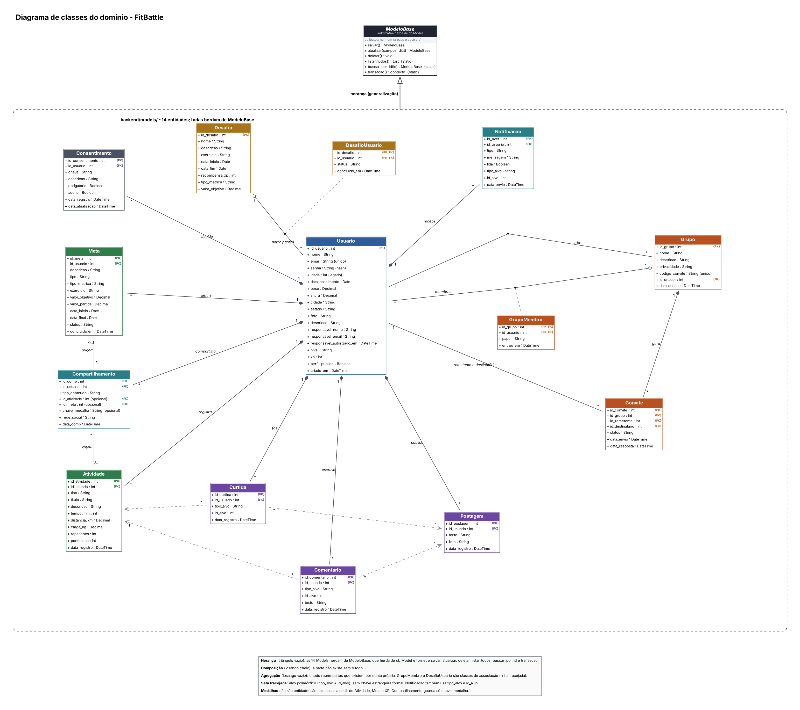
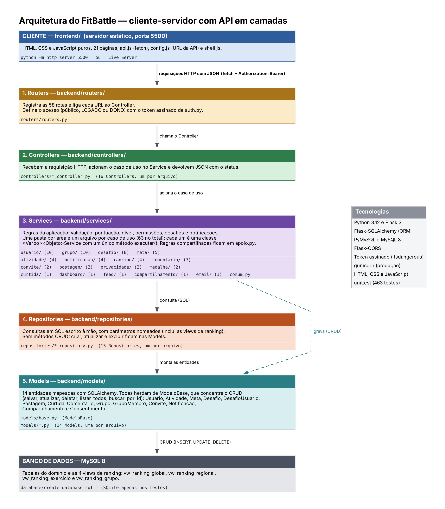
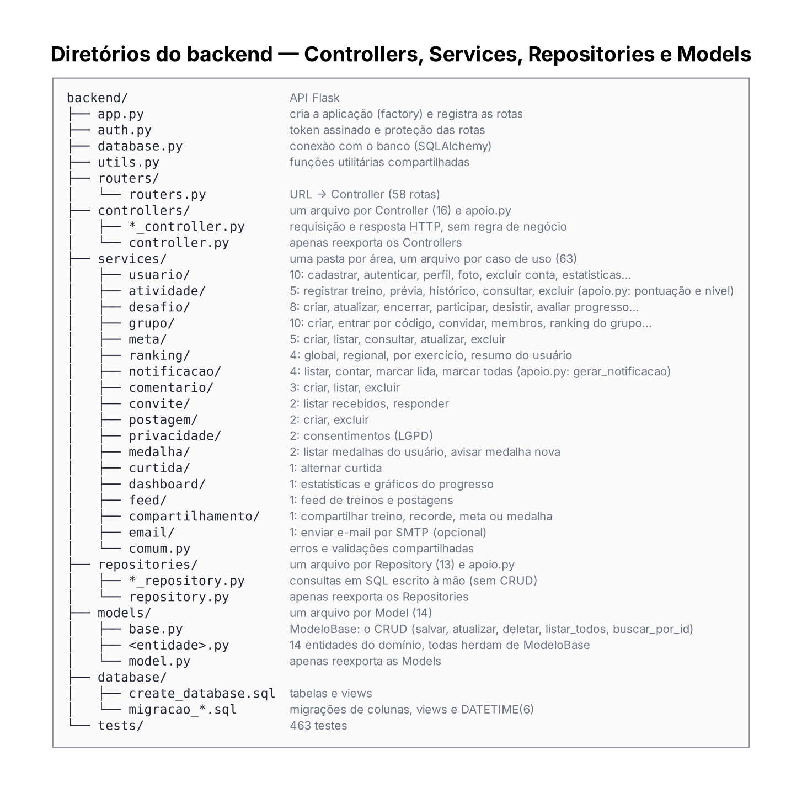
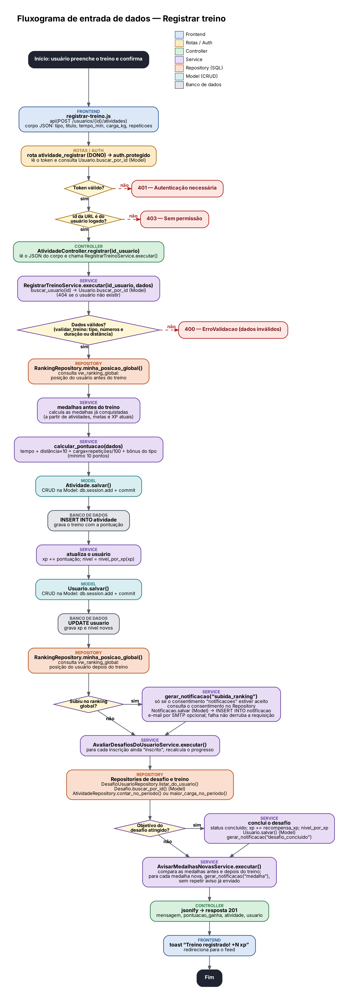
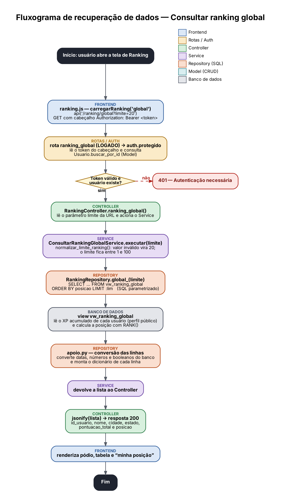

# Fit-Battle

[](https://github.com/fitbatle/Fit-Battle/actions/workflows/testes.yml)

Bernardo Nardelli, Cauã Gomes, João Paulo Costa, João Pedro Braga, Miguel Assunção, Henrique Vale.

Plataforma gamificada de treinos. Este repositório contém a API (Flask) e o
frontend web.

## Casos de uso implementados

Levantamento conferido contra o código atual (rotas registradas e serviços
que as implementam), não só contra as tabelas do SQL — uma tabela existir no
schema não significa que a funcionalidade esteja implementada.

- RF01 — Cadastro (nome, data de nascimento, e-mail, senha)
- RF02 — Login e autenticação, com token assinado
- RF03 — Perfil (visualizar/editar, foto, nível, bio)
- RF04 — Registrar atividade (tipo, tempo, distância, carga/repetições)
- RF05 — Histórico completo de atividades
- RF06 — Criar grupos privados de competição
- RF07 — Convidar via link/código ou busca direta
- RF08 — Aceitar/recusar convites
- RF09 — Ranking interno do grupo
- RF10 — Ranking regional, por "Da sua cidade" ou "Do seu estado" (a cidade é comparada sem diferença de caixa, acentos ou espaços nas pontas)
- RF11 — Ranking global
- RF12 — Cálculo automático de pontuação por atividade
- RF13 — Atribuição automática de nível/categoria por XP (cinco categorias)
- RF14 — Dashboard com XP por semana, treinos por semana, distribuição por tipo de treino, evolução da carga máxima por exercício, sequência atual e melhor sequência, e totais (gráficos em SVG/JS puro, sem biblioteca externa); só dados do próprio usuário
- RF15 — Criar/gerenciar metas pessoais (curto/longo prazo)
- RF16 — Desafios sazonais propostos pela administração (e-mails em `ADMIN_EMAILS`, únicos que criam/editam/encerram desafios); qualquer usuário logado participa ou desiste pela aba "Desafios" dentro de `metas.html`; progresso sempre calculado a partir dos treinos reais no período do desafio (`exercicio: "livre"` conta qualquer treino, senão filtra pelo título); ao atingir o objetivo credita `recompensa_xp` uma única vez (idempotente, avaliado ao registrar treino e também ao ler) e dispara notificação (RF18); cada usuário só vê/mexe na própria inscrição- RF17 — Bloco "Em Andamento" com metas ativas e desafios em que o usuário está inscrito (percentual e status reais, link para o detalhe de cada um), em dois lugares: `dashboard.html` e na aba "Desafios" de `metas.html`
- RF18 — Notificações in-app (sino no header com contador de não lidas, atualizado a cada 60s e pausado com a aba oculta; página `/notificacoes`) para convite recebido/aceito, curtida e comentário recebidos, meta concluída e subida de posição no ranking global — sempre condicionado ao consentimento "notificacoes", nunca autonotificação, sem duplicar ao curtir/descurtir; e-mail opcional por SMTP (`SMTP_HOST`, `SMTP_PORT`, `SMTP_USER`, `SMTP_PASSWORD`, `SMTP_FROM`), tolerante a falha e nunca bloqueando a requisição; push do navegador fora do escopo
- RF19 — Busca de perfis (nome ou cidade, restrita a campos públicos, nunca menores de idade) e busca de grupos (entre os grupos dos quais o usuário já é membro, com entrada por código de convite na mesma tela)
- RF20 — Compartilhar treino registrado, recorde pessoal, meta concluída e medalha conquistada em redes sociais externas (Web Share API, WhatsApp, X, Telegram ou copiar texto), condicionado ao consentimento "compartilhamento" e registrado na tabela `compartilhamento`. As medalhas são calculadas a partir dos dados reais (primeiro treino, constância de 10 e veterano de 50 atividades, semana perfeita de 7 dias seguidos, meta batida, maratonista de 42 km e uma medalha por categoria acima da inicial do RF13). Não alteram XP nem ranking. Ao conquistar uma medalha nova, o usuário recebe uma notificação, sem repetição, com o mesmo consentimento de notificações. Perfil próprio mostra todas, com progresso real; perfil público mostra só as conquistadas. A medalha "Campeão de desafio" não existe porque o sistema não calcula posição final em desafio concluído.

## Funcionalidades Implementadas

Cada item indica a tela, a rota da API, o Controller e o método, o Service e o Repository ou Model usados. Exceto cadastro, login e estatísticas gerais, as rotas exigem token.

1. Cadastrar usuário
   Tela: `index.html`; rota: `POST /api/usuarios`; Controller: `UsuarioController.cadastrar`; Service: `CadastrarUsuarioService`; Repository/Model: `Usuario.salvar`, `Usuario`.
2. Entrar no sistema
   Tela: `login.html`; rota: `POST /api/login`; Controller: `UsuarioController.login`; Service: `AutenticarUsuarioService`; Repository/Model: `UsuarioRepository.buscar_por_email`, `Usuario`.
3. Editar perfil
   Tela: `perfil.html`; rota: `PUT /api/usuarios/<id>`; Controller: `UsuarioController.atualizar`; Service: `AtualizarPerfilService`; Repository/Model: `Usuario.atualizar`, `Usuario`.
4. Enviar foto de perfil
   Tela: `perfil.html`; rota: `POST /api/usuarios/<id>/foto`; Controller: `UsuarioController.upload_foto`; Service: `AtualizarFotoPerfilService`; Repository/Model: `Usuario.salvar`, `Usuario`.
5. Buscar perfis
   Tela: `busca.html`; rota: `GET /api/usuarios/busca`; Controller: `UsuarioController.busca`; Service: `BuscarPerfisService`; Repository/Model: `UsuarioRepository.buscar_publicos`, `Usuario`.
6. Registrar treino
   Tela: `registrar-treino.html`; rota: `POST /api/usuarios/<id>/atividades`; Controller: `AtividadeController.registrar`; Service: `RegistrarTreinoService`; Repository/Model: `Atividade.salvar`, `Atividade`.
7. Ver histórico de treinos
   Tela: `perfil.html`; rota: `GET /api/usuarios/<id>/atividades`; Controller: `AtividadeController.historico`; Service: `ConsultarHistoricoTreinosService`; Repository/Model: `AtividadeRepository.listar_do_usuario`, `Atividade`.
8. Excluir treino
   Tela: `perfil.html`; rota: `DELETE /api/atividades/<id>`; Controller: `AtividadeController.excluir`; Service: `ExcluirAtividadeService`; Repository/Model: `Atividade.buscar_por_id` e `Atividade.deletar`, `Atividade`.
9. Ver painel de desempenho
   Tela: `dashboard.html`; rota: `GET /api/dashboard`; Controller: `DashboardController.resumo`; Service: `ConsultarDashboardService`; Repository/Model: `AtividadeRepository` (totais, distribuição por tipo, pontuações), `Atividade`.
10. Curtir publicação do feed
    Tela: `feed.html`; rota: `POST /api/feed/<tipo>/<id>/curtir`; Controller: `CurtidaController.alternar`; Service: `AlternarCurtidaService`; Repository/Model: `CurtidaRepository.buscar`, `Curtida.salvar` e `Curtida.deletar`, `Curtida`.
11. Comentar no feed
    Tela: `feed.html`; rota: `POST /api/feed/<tipo>/<id>/comentarios`; Controller: `ComentarioController.criar`; Service: `CriarComentarioService`; Repository/Model: `Comentario.salvar`, `Comentario`.
12. Ver ranking global
    Tela: `ranking.html`; rota: `GET /api/ranking/global`; Controller: `RankingController.ranking_global`; Service: `ConsultarRankingGlobalService`; Repository/Model: `RankingRepository.global_` (view `vw_ranking_global`).
13. Ver ranking da cidade
    Tela: `ranking.html`; rota: `GET /api/ranking/regional`; Controller: `RankingController.ranking_regional`; Service: `ConsultarRankingRegionalService`; Repository/Model: `RankingRepository.regional_todos` (view `vw_ranking_regional`).
14. Criar grupo
    Tela: `grupo-criar.html`; rota: `POST /api/grupos`; Controller: `GrupoController.criar`; Service: `CriarGrupoService`; Repository/Model: `Grupo.salvar` e `GrupoMembro.salvar`, `Grupo`, `GrupoMembro`.
15. Convidar membro para grupo
    Tela: `grupo-convidar.html`; rota: `POST /api/grupos/<id>/convites`; Controller: `GrupoController.convidar`; Service: `ConvidarParaGrupoService`; Repository/Model: `Convite.salvar`, `Convite`.
16. Responder convite de grupo
    Tela: `grupo.html`; rota: `PUT /api/convites/<id>`; Controller: `ConviteController.responder`; Service: `ResponderConviteService`; Repository/Model: `Convite.buscar_por_id` e `Convite.salvar`, `GrupoMembro.salvar`, `Convite`.
17. Ver ranking do grupo
    Tela: `grupo-detalhes.html`; rota: `GET /api/grupos/<id>/ranking`; Controller: `GrupoController.ranking`; Service: `ConsultarRankingGrupoService`; Repository/Model: `RankingRepository.grupo` (view `vw_ranking_grupo`).
18. Criar meta
    Tela: `metas-criar.html`; rota: `POST /api/metas`; Controller: `MetaController.criar`; Service: `CriarMetaService`; Repository/Model: `Meta.salvar`, `Meta`.
19. Atualizar meta
    Tela: `metas-detalhes.html`; rota: `PUT /api/metas/<id>`; Controller: `MetaController.atualizar`; Service: `AtualizarMetaService`; Repository/Model: `Meta.salvar`, `Meta`.
20. Excluir meta
    Tela: `metas-detalhes.html`; rota: `DELETE /api/metas/<id>`; Controller: `MetaController.excluir`; Service: `ExcluirMetaService`; Repository/Model: `Meta.deletar`, `Meta`.
21. Criar desafio (somente administradores)
    Tela: `metas.html`; rota: `POST /api/desafios`; Controller: `DesafioController.criar`; Service: `CriarDesafioService`; Repository/Model: `Desafio.salvar`, `Desafio`.
22. Participar de desafio
    Tela: `metas.html`; rota: `POST /api/desafios/<id>/participar`; Controller: `DesafioController.participar`; Service: `ParticiparDesafioService`; Repository/Model: `DesafioUsuario.buscar_por_id` e `DesafioUsuario.salvar`, `DesafioUsuario`.
23. Ver notificações
    Tela: `notificacoes.html`; rota: `GET /api/notificacoes`; Controller: `NotificacaoController.listar`; Service: `ListarNotificacoesService`; Repository/Model: `NotificacaoRepository.listar_do_usuario`, `Notificacao`.
24. Marcar todas as notificações como lidas
    Tela: `notificacoes.html`; rota: `PUT /api/notificacoes/lidas`; Controller: `NotificacaoController.marcar_todas_lidas`; Service: `MarcarTodasNotificacoesLidasService`; Repository/Model: `NotificacaoRepository.marcar_todas_lidas`, `Notificacao`.
25. Compartilhar treino, recorde, meta ou medalha
   Tela: `feed.html`, `perfil.html`, `registrar-treino.html` e `metas-detalhes.html` (componente `compartilhar.js`); rota: `POST /api/compartilhamentos`; Controller: `CompartilhamentoController.registrar`; Service: `RegistrarCompartilhamentoService`; Repository/Model: `Consentimento.buscar_por_id` (consentimento "compartilhamento"), `Atividade.buscar_por_id`, `Meta.buscar_por_id`, `Compartilhamento.salvar`, `Compartilhamento`.
26. Ver medalhas
   Tela: `perfil.html` (componente `medalhas.js`); rota: `GET /api/usuarios/<id>/medalhas`; Controller: `MedalhaController.listar`; Service: `ListarMedalhasService`; Repository/Model: `AtividadeRepository.listar_do_usuario`, `MetaRepository.listar_do_usuario`, `Atividade`, `Meta`.
27. Ver ranking do estado
   Tela: `ranking.html` (aba "Do seu estado"); rota: `GET /api/ranking/regional?estado=<UF>`; Controller: `RankingController.ranking_regional`; Service: `ConsultarRankingRegionalService`; Repository/Model: `RankingRepository.regional_todos` (view `vw_ranking_regional`), `Usuario`.
28. Buscar meus grupos
   Tela: `busca.html` (aba "Grupos", filtro pelo nome); rota: `GET /api/grupos`; Controller: `GrupoController.listar_meus`; Service: `ListarMeusGruposService`; Repository/Model: `GrupoRepository.listar_do_usuario`, `GrupoRepository.contar_membros`, `Grupo`, `GrupoMembro`.
29. Alterar senha
   Tela: `perfil.html` (campos de senha atual e nova senha); rota: `PUT /api/usuarios/<id>`; Controller: `UsuarioController.atualizar`; Service: `AtualizarPerfilService`; Repository/Model: `UsuarioRepository.buscar_por_email`, `Usuario.atualizar`, `Usuario`.
30. Listar metas
   Tela: `metas.html`; rota: `GET /api/metas`; Controller: `MetaController.listar`; Service: `ListarMetasService`; Repository/Model: `MetaRepository.listar_do_usuario`, `Meta`.
31. Ver metas e desafios em andamento
   Tela: `dashboard.html` (bloco "Em andamento"); rotas: `GET /api/metas` e `GET /api/desafios`; Controller: `MetaController.listar` e `DesafioController.listar`; Service: `ListarMetasService` e `ListarDesafiosAtivosService`; Repository/Model: `MetaRepository.listar_do_usuario`, `DesafioRepository.listar_ativos`, `Meta`, `Desafio`.
32. Desistir de desafio
   Tela: `metas.html` (aba "Desafios"); rota: `DELETE /api/desafios/<id>/participar`; Controller: `DesafioController.desistir`; Service: `DesistirDesafioService`; Repository/Model: `DesafioUsuario.buscar_por_id` e `DesafioUsuario.salvar`, `DesafioUsuario`.
33. Prever pontos de um treino antes de salvar
   Tela: `registrar-treino.html` (painel de prévia e recompensa estimada); rota: `POST /api/usuarios/<id>/atividades/previa`; Controller: `AtividadeController.previa`; Service: `PreverTreinoService`; Repository/Model: `AtividadeRepository.maior_carga` e `pontuacao_total_desde`, `Atividade`. Não grava nada.
34. Registrar recorde pessoal
   Tela: `registrar-treino.html` (aviso de recorde após salvar e linha "Seu recorde atual"); rota: `POST /api/usuarios/<id>/atividades` (campo `recorde_pessoal` na resposta); Controller: `AtividadeController.registrar`; Service: `RegistrarTreinoService`; Repository/Model: `AtividadeRepository.maior_carga` e `Atividade.salvar`, `Atividade`.
35. Ver nível e progresso até o próximo nível
   Tela: `perfil.html` (barra de nível); rota: `GET /api/eu` (campo `progresso_nivel`); Controller: `UsuarioController.eu`; Service: `ConsultarProgressoNivelService`; Model: `Usuario` (campo `xp`).

Diagrama de classes das entidades: `docs/diagrama_de_classes_dominio.svg` (versão em imagem: `docs/diagrama_de_classes_dominio.png`).

## Arquitetura em camadas

Fluxo de uma requisição: **routers → controller → service → repository → model → MySQL**.
Cada seta só anda num sentido: `controllers/` importa só `services/` (e utilitários
como `auth.py`); `services/` pode importar `models/` e `repositories/`, mas nunca
`database` nem `sqlalchemy`; fora de `models/` e `repositories/` ninguém importa
`sqlalchemy` nem usa `db.session`. Essa regra
é verificada por `backend/tests/test_arquitetura.py`, que analisa os imports de cada
arquivo (não só roda os testes — lê o código-fonte) e falha se alguma camada importar
o que não devia.

`services/` é uma pasta por área (`usuario/`, `atividade/`, `grupo/`, ...), com um
arquivo por caso de uso — uma única classe pública terminada em `Service`, com um
único método público estático `executar(...)`. Lógica compartilhada entre casos de
uso da mesma área fica em `<área>/apoio.py` (só funções, sem classe); o que é
exclusivo de um caso de uso fica privado no próprio arquivo. `test_arquitetura.py`
(classe `TestServicesPorCasoDeUso`) verifica isso por AST e também que nenhum
arquivo de `services/` importa o pacote de outra área direto (sempre o módulo
completo, ex.: `services.usuario.apoio`) e que a raiz de `services/` só tem
`__init__.py` e `comum.py` soltos.

### CRUD nos Models, consultas em SQL nos Repositories

Operações simples de cadastro e manutenção ficam nos Models, herdeiros de `ModeloBase`
(`models/base.py`): `salvar()`, `atualizar(campos)`, `deletar()`, `buscar_por_id(chave)` e
`listar_todos()`. Os Services chamam esses métodos diretamente. Quando uma operação grava
mais de uma linha, o Service a envolve em `Modelo.transacao()`, que faz um único commit ao
final ou desfaz tudo se algo falhar (ex.: registrar treino com XP, medalhas e notificações;
excluir conta; participar e concluir desafio). Conflito de chave única ou erro de integridade
vira `ConflitoDeDados` (definido em `utils.py`), que o Service converte em resposta HTTP 409.

As consultas que não são CRUD simples (listagens filtradas, junções, agregações, rankings,
busca por texto e exclusões em lote) ficam em `repositories/`, escritas em SQL com parâmetros
nomeados (`text(...)`, nunca texto montado com valores). Elas devolvem dicionários (ou lista
de dicionários). Quando um Service precisa alterar a entidade, ele recebe o Model pelo
`buscar_por_id`. Os helpers de `repositories/apoio.py` são o único ponto que normaliza tipos
entre SQLite e MySQL: datas (texto ou `datetime`, sempre em UTC sem fuso), booleanos e
números (float). A formatação do JSON de cada entidade fica em `formatar(...)` no próprio
Model, usada tanto pelo `to_dict()` quanto pelas listas.

Diferenças conhecidas entre SQLite e MySQL: a busca por texto (`LIKE`) segue a collation de
cada banco. No SQLite, a comparação é sensível a maiúsculas e a acentos fora do ASCII; no
MySQL com `utf8mb4_unicode_ci`, não é. Comparações de texto na ordenação dos resultados são
feitas em Python, para que a ordem seja a mesma nos dois bancos.

Hoje (conferido direto na árvore de arquivos): 58 rotas registradas em
`routers.py`, 16 classes `Controller` em `controllers/` (uma por arquivo),
63 classes `Service` de caso de uso em `services/` (uma por arquivo), 13
classes `Repository` em `repositories/` (uma por arquivo), 14 classes `Model`
em `models/` (uma por arquivo, todas herdando de `ModeloBase`), 10 arquivos
`apoio.py` em `services/` (um por área que precisa de lógica compartilhada),
mais um `apoio.py` em `controllers/` e um em `repositories/`, e 463 testes.

| Caso de uso | Controller | Service | Repository |
|---|---|---|---|
| Cadastro | `UsuarioController.cadastrar` | `CadastrarUsuarioService.executar` | `Usuario.salvar` |
| Login | `UsuarioController.login` | `AutenticarUsuarioService.executar` | `UsuarioRepository.buscar_por_email` |
| Perfil (ver) | `UsuarioController.buscar` | `ConsultarPerfilService.executar` | — (via `usuario/apoio.py`) |
| Perfil (editar) | `UsuarioController.atualizar` | `AtualizarPerfilService.executar` | `Usuario.atualizar` |
| Busca de perfis | `UsuarioController.busca` | `BuscarPerfisService.executar` | `UsuarioRepository.buscar_publicos` |
| Registrar treino | `AtividadeController.registrar` | `RegistrarTreinoService.executar` | `Atividade.salvar` |
| Histórico de atividades | `AtividadeController.historico` | `ConsultarHistoricoTreinosService.executar` | `AtividadeRepository.listar_do_usuario` |
| Ranking global | `RankingController.ranking_global` | `ConsultarRankingGlobalService.executar` | `RankingRepository.global_` |
| Ranking regional | `RankingController.ranking_regional` | `ConsultarRankingRegionalService.executar` | `RankingRepository.regional_todos` |
| Ranking por exercício | `RankingController.ranking_por_exercicio` | `ConsultarRankingPorExercicioService.executar` | `RankingRepository.por_exercicio` |
| Ranking interno do grupo | `GrupoController.ranking` | `ConsultarRankingGrupoService.executar` | `RankingRepository.grupo` |
| Grupos | `GrupoController.criar` | `CriarGrupoService.executar` | `Grupo.salvar` |
| Convidar para grupo | `GrupoController.convidar` | `ConvidarParaGrupoService.executar` | `Convite.salvar` |
| Convites (responder) | `ConviteController.responder` | `ResponderConviteService.executar` | `Convite.buscar_por_id` |
| Metas | `MetaController.criar` | `CriarMetaService.executar` | `Meta.salvar` |
| Feed (listagem) | `FeedController.listar` | `ListarFeedService.executar` | `AtividadeRepository`/`PostagemRepository`/`CurtidaRepository`/`ComentarioRepository` |
| Postagem | `PostagemController.criar` | `CriarPostagemService.executar` | `Postagem.salvar` |
| Curtida | `CurtidaController.alternar` | `AlternarCurtidaService.executar` | `CurtidaRepository.buscar`, `Curtida.salvar`/`deletar` |
| Comentário | `ComentarioController.criar` | `CriarComentarioService.executar` | `Comentario.salvar` |
| Consentimentos | `ConsentimentoController.atualizar` | `AtualizarConsentimentoService.executar` | `Consentimento.buscar_por_id`/`salvar` |
| Compartilhamento | `CompartilhamentoController.registrar` | `RegistrarCompartilhamentoService.executar` | `CompartilhamentoRepository`/`AtividadeRepository`/`ConsentimentoRepository` |
| Dashboard | `DashboardController.resumo` | `ConsultarDashboardService.executar` | `AtividadeRepository.pontuacoes_desde` (+ demais agregações) |
| Notificações | `NotificacaoController.listar` | `ListarNotificacoesService.executar` | `NotificacaoRepository.listar_do_usuario` |
| Desafios | `DesafioController.listar` | `ListarDesafiosAtivosService.executar` | `DesafioRepository.listar_ativos` |
| Medalhas | `MedalhaController.listar` | `ListarMedalhasService.executar` | `AtividadeRepository.listar_do_usuario` / `MetaRepository.listar_do_usuario` |

Busca de grupos (RF19) não tem linha própria porque não criou nenhum
método novo: `frontend/busca.js` reaproveita o `GET /api/grupos`
(mesmo `GrupoController.listar_meus` → `ListarMeusGruposService.executar` já
usado em `grupo.html`) e filtra pelo nome só no navegador.

RF17 (bloco "Em Andamento") também não tem linha própria: é agregação
pura no frontend (`dashboard.js` e `metas.js`) sobre as respostas já
existentes de `GET /api/metas` e `GET /api/desafios`, sem nenhuma rota,
Controller, Service ou Repository novo.

## Estrutura

```
.
├── README.md
├── .gitignore
├── backend/
│   ├── app.py                  # cria e sobe a aplicação Flask
│   ├── auth.py                 # token (itsdangerous), decorator protegido()
│   ├── database.py             # instância do SQLAlchemy (objeto db)
│   ├── utils.py                # agora(), iso_utc(), calcular_idade() — usados por models e services
│   ├── gunicorn.conf.py        # workers = 1 (ver seção "gunicorn" abaixo)
│   ├── requirements.txt
│   ├── database/
│   │   ├── create_database.sql           # schema completo, para instalação nova
│   │   ├── migracao_meta.sql             # atualiza um banco existente (ver "Atualizando o banco")
│   │   ├── migracao_data_nascimento.sql  # idem, para a coluna data_nascimento
│   │   ├── migracao_notificacao_alvo.sql # idem, para as colunas tipo_alvo/id_alvo de notificacao
│   │   ├── migracao_desafio_metrica.sql  # idem, para as colunas tipo_metrica/valor_objetivo de desafio
│   │   ├── migracao_medalha.sql          # idem, para o tipo 'medalha' e a coluna chave_medalha de compartilhamento
│   │   ├── migracao_xp_ranking.sql       # recria as views de ranking para ler usuario.xp (pode ser rodada quantas vezes precisar)
│   │   └── migracao_datetime_microsegundos.sql  # colunas de data passam a guardar microssegundos (DATETIME(6))
│   ├── routers/
│   │   └── routers.py          # mapeia as URLs para os Controllers
│   ├── controllers/             # uma classe Controller por arquivo
│   │   ├── apoio.py             # auxiliares de requisição (id logado, IP, corpo JSON)
│   │   ├── usuario_controller.py
│   │   ├── atividade_controller.py
│   │   ├── postagem_controller.py
│   │   ├── feed_controller.py
│   │   ├── curtida_controller.py
│   │   ├── comentario_controller.py
│   │   ├── medalha_controller.py
│   │   ├── ranking_controller.py
│   │   ├── consentimento_controller.py
│   │   ├── grupo_controller.py
│   │   ├── convite_controller.py
│   │   ├── notificacao_controller.py
│   │   ├── dashboard_controller.py
│   │   ├── compartilhamento_controller.py
│   │   ├── meta_controller.py
│   │   ├── desafio_controller.py
│   │   └── controller.py        # só reexporta as classes (imports antigos continuam funcionando)
│   ├── services/                # regra de negócio; uma pasta por área, um arquivo por caso de uso
│   │   ├── comum.py             # ErroValidacao, upload/validação de imagem
│   │   ├── usuario/              # cadastro, login, perfil, foto, conta, estatísticas
│   │   │   ├── apoio.py           # buscar_usuario, validações de idade/e-mail compartilhadas
│   │   │   └── limitador_login.py # _LimitadorLogin (tentativas de login), em memória
│   │   ├── privacidade/           # consentimentos LGPD (apoio.py: registrar_consentimentos_iniciais)
│   │   ├── atividade/             # registrar/consultar/excluir treino, histórico
│   │   │   └── apoio.py           # cálculo de pontuação e de nível por XP (FAIXAS_NIVEL)
│   │   ├── postagem/              # criar/excluir postagem
│   │   ├── feed/                  # feed combinado (treinos + postagens)
│   │   ├── curtida/               # curtir/descurtir
│   │   ├── comentario/            # criar/listar/excluir comentário
│   │   ├── ranking/                # global, regional, por exercício, resumo do usuário
│   │   ├── grupo/                  # criar, convidar, entrar por código, ranking interno
│   │   ├── convite/                # listar recebidos, responder
│   │   ├── meta/                   # criar/consultar/atualizar/excluir/listar metas
│   │   ├── compartilhamento/       # registrar compartilhamento externo
│   │   ├── dashboard/              # resumo agregado do próprio usuário
│   │   ├── desafio/                # criar/atualizar/encerrar/participar/desistir, avaliação automática
│   │   ├── email/                  # EnviarEmailService: envio SMTP opcional, configurado por variáveis de ambiente
│   │   └── notificacao/            # gerar/listar/marcar lida; chama o Service de e-mail
│   ├── repositories/            # um Repository por arquivo; único ponto de acesso ao banco
│   │   ├── apoio.py             # constantes e funções auxiliares das consultas
│   │   ├── usuario_repository.py
│   │   ├── atividade_repository.py
│   │   ├── postagem_repository.py
│   │   ├── curtida_repository.py
│   │   ├── comentario_repository.py
│   │   ├── consentimento_repository.py
│   │   ├── ranking_repository.py
│   │   ├── grupo_repository.py
│   │   ├── convite_repository.py
│   │   ├── meta_repository.py
│   │   ├── desafio_repository.py
│   │   ├── desafio_usuario_repository.py
│   │   ├── compartilhamento_repository.py
│   │   ├── notificacao_repository.py
│   │   └── repository.py        # só reexporta as classes
│   ├── models/                  # uma Model por arquivo, todas herdando de ModeloBase
│   │   ├── base.py              # ModeloBase: salvar, atualizar, deletar, listar_todos, buscar_por_id
│   │   ├── usuario.py
│   │   ├── atividade.py
│   │   ├── postagem.py
│   │   ├── curtida.py
│   │   ├── comentario.py
│   │   ├── grupo.py
│   │   ├── grupo_membro.py
│   │   ├── convite.py
│   │   ├── meta.py
│   │   ├── notificacao.py
│   │   ├── desafio.py
│   │   ├── desafio_usuario.py
│   │   ├── compartilhamento.py
│   │   ├── consentimento.py
│   │   └── model.py             # só reexporta as Models (imports antigos continuam funcionando)
│   └── tests/
│       ├── apoio.py             # recria as views de ranking em SQLite para os testes
│       ├── servidor_dev.py      # API com SQLite populado de dados de exemplo
│       ├── test_arquitetura.py  # análise estática das regras de camada acima
│       ├── test_seguranca.py
│       ├── test_robustez.py
│       ├── test_grupos.py
│       ├── test_metas.py
│       ├── test_ranking.py
│       ├── test_compartilhamento.py
│       ├── test_dashboard.py
│       ├── test_notificacao.py
│       ├── test_desafio.py
│       ├── test_modelos_base.py  # os cinco métodos da ModeloBase nas 14 Models
│       └── test_envio_email.py   # EnviarEmailService com SMTP simulado
└── frontend/
    ├── config.js                                         # window.FITBATTLE_API_URL (ver "Como rodar")
    ├── compartilhar.js                                   # menu de compartilhamento (RF20), compartilhado
    ├── medalhas.js / medalhas.css                        # cartões de medalha, usados em perfil e perfil público (RF20)
    ├── busca.html / busca.js / busca.css                # busca de perfis e de grupos (RF19)
    ├── perfil-publico.html / perfil-publico.js / .css    # perfil de outro usuário, só leitura (RF19)
    ├── dashboard.html / dashboard.js / dashboard.css     # gráficos SVG/JS puro, só do próprio usuário (RF14)
    ├── notificacoes.html / notificacoes.js / .css        # lista completa, sino no header é em shell.js (RF18)
    ├── login.html / login.js, index.html / script.js   # login e cadastro
    ├── perfil.html / perfil.js                          # perfil, treinos, foto
    ├── feed.html / feed.js                               # feed social
    ├── grupo*.html / grupo*.js, entrar-grupo.*           # grupos e convites
    ├── metas*.html / metas*.js                           # metas pessoais; metas.html tem a aba "Desafios" (RF16)
    ├── desafio-detalhes.html / desafio-detalhes.js       # detalhe de 1 desafio sazonal (RF16)
    ├── ranking.html / ranking.js                         # rankings
    ├── privacidade.html / privacidade.js                 # consentimentos LGPD
    ├── mockups/                                          # telas de outro integrante do grupo,
    │                                                      # não referenciadas pelo app (perfil-A/B/C.html)
    └── api.js, shell.js, auth-comum.js, tokens.css, ...  # compartilhados entre as páginas
```

## Documentação do projeto


Diagrama de classes do domínio: as 14 entidades do banco, com PK/FK e os relacionamentos entre elas.


Arquitetura cliente-servidor: frontend estático e API Flask em camadas (routers → controllers → services → repositories → models → MySQL).


Estrutura de diretórios do backend, com uma frase sobre o que cada Service faz.


Fluxograma de entrada de dados: POST /api/usuarios/&lt;id&gt;/atividades, da rota ao banco, passando por desafios, notificações e atualização de XP/nível.


Fluxograma de recuperação de dados: GET /api/ranking/global, da rota até a view `vw_ranking_global`.

## Como rodar

### 1. Banco de dados (MySQL 8+) — instalação nova

Rode o script `backend/database/create_database.sql` inteiro:

```bash
mysql -u root -p < backend/database/create_database.sql
```

Ou pelo MySQL Workbench: *File > Open SQL Script* > selecione o arquivo >
botão do raio (Execute All).

O script cria o banco `fitbattle`, todas as tabelas e views, e o usuário de
aplicação `fitbattle` / senha `Fitbattle@123` (usado pela API, não pelo
root). Essa senha é só um exemplo para desenvolvimento local; troque-a (e
configure `DB_PASSWORD` com o novo valor) em qualquer ambiente compartilhado
ou de produção.

Se você já tem um banco `fitbattle` de antes da feature de Metas (RF15) ou
de antes da coluna `data_nascimento` e quer **manter os dados**, não rode
`create_database.sql` de novo — veja "Atualizando o banco" abaixo.

### 2. Backend

```bash
cd backend
pip install -r requirements.txt
python app.py
```

A API sobe em `http://localhost:5000`. Deixe esse terminal aberto enquanto
usa o sistema — se fechar (ou o PC reiniciar), rode `python app.py` de novo.

> O pacote `cryptography` está no `requirements.txt` porque o MySQL 8 usa o
> método de autenticação `caching_sha2_password`, e o PyMySQL precisa dele
> para conectar.

Variáveis de ambiente aceitas (todas opcionais, já vêm com padrão):
`DB_USER` (fitbattle), `DB_PASSWORD`, `DB_HOST` (localhost),
`DB_PORT` (3306), `DB_NAME` (fitbattle), `DB_URI` (sobrescreve as cinco
anteriores, usado pelos testes com SQLite), `FITBATTLE_ENV`, `SECRET_KEY`,
`FLASK_DEBUG`
(desligado por padrão; defina como `1` só em desenvolvimento), `TRUST_PROXY`
(`1` faz o limite de tentativas de login usar o primeiro IP de `X-Forwarded-For`;
ligue só atrás de um proxy que você controla),
`CORS_EXTRA_ORIGENS` (origens extras separadas por vírgula, além de
localhost/127.0.0.1/IPs de rede local, já liberados por padrão),
`SMTP_HOST`/`SMTP_PORT`/`SMTP_USER`/`SMTP_PASSWORD`/`SMTP_FROM` (envio de
e-mail para as notificações do RF18; sem `SMTP_HOST` definido, as
notificações continuam só in-app), `ADMIN_EMAILS` (e-mails separados por
vírgula com permissão para criar, editar e encerrar desafios sazonais —
RF16; sem essa variável, nenhum usuário é administrador).

`DB_PASSWORD` não tem padrão no código de produção. Em desenvolvimento, se a
variável faltar, a API usa a senha de exemplo `Fitbattle@123` e imprime um
aviso no terminal. Com `FITBATTLE_ENV=production`, a API recusa iniciar se
`DB_PASSWORD` não estiver definida (a exceção é `DB_URI`, que já traz a senha
dentro da própria URI). O arquivo `backend/.env.example` lista todas as
variáveis; a aplicação não carrega esse arquivo sozinha, então exporte as
variáveis no ambiente ou use o gerenciador de variáveis da sua hospedagem.

### 3. Rodar com dados de exemplo (sem MySQL)

```bash
cd backend
ADMIN_EMAILS=helena@fitbattle.dev python tests/servidor_dev.py
```

No Windows (PowerShell), defina a variável antes de rodar:

```powershell
cd backend
$env:ADMIN_EMAILS = "helena@fitbattle.dev"
python tests\servidor_dev.py
```

Sobe a API num banco SQLite local (`backend/dev.db`), já populado com ~12
usuários e treinos de teste, sem precisar de MySQL. Útil para demonstração
rápida ou para olhar o frontend sem configurar banco nenhum. A variável
`ADMIN_EMAILS` é opcional, mas sem ela nenhum usuário consegue criar desafios.
Login de teste: `helena@fitbattle.dev` / `senhaforte123`.

### 4. Suíte de testes

```bash
cd backend
python -m unittest discover -s tests -t .
```

463 testes atualmente, cobrindo autenticação/LGPD (incluindo as fronteiras de
13 e 18 anos), robustez (uploads, limite de login, concorrência),
grupos/convites, metas, compartilhamento, busca restrita (nome, cidade,
menores de idade, perfil revogado), rankings, dashboard (estado vazio,
totais, sequências, evolução de carga, isolamento entre usuários) e a
análise estática das camadas (incluindo a regra de uma classe `Service` por
caso de uso, um método `executar` e os imports entre áreas de `services/`).

## Rodar em outro computador

Requisitos: Python 3.11 ou 3.12. Para a demonstração não é preciso MySQL: a API roda
com um banco SQLite com dados de exemplo. Testado com Python 3.12.10 no Windows 11.

### Demonstração em um comando

No Windows, dê duplo clique em `iniciar-demo.bat` (ou rode `.\iniciar-demo.bat` no
PowerShell). No Linux ou macOS:

```bash
./iniciar-demo.sh
```

Se o arquivo não estiver marcado como executável, use `bash iniciar-demo.sh`.

Os dois scripts criam a pasta `.venv` (na primeira vez), instalam as dependências,
sobem a API na porta 5000 com dados de demonstração e o frontend na porta 5500.
Abra `http://localhost:5500/login.html` e entre com `helena@fitbattle.dev` e
`senhaforte123`.

Por padrão a demonstração só fica acessível neste computador (`127.0.0.1`). Para abrir de outro aparelho da mesma rede, defina `FITBATTLE_REDE=1` antes de rodar e use `http://IP_DESTE_COMPUTADOR:5500/login.html`. Use só em rede de confiança, porque a conta de demonstração tem senha pública. Libere as portas 5000 e 5500 no firewall na primeira vez.

### Passo a passo manual

Windows (PowerShell):

```powershell
py -3 -m venv .venv
.venv\Scripts\Activate.ps1
python -m pip install -r backend\requirements.txt
cd backend
$env:HOST = "127.0.0.1"
$env:ADMIN_EMAILS = "helena@fitbattle.dev"
python tests\servidor_dev.py
```

Em outra janela, na pasta do projeto:

```powershell
cd frontend
python -m http.server 5500 --bind 127.0.0.1
```

Linux e macOS:

```bash
python3 -m venv .venv
. .venv/bin/activate
python -m pip install -r backend/requirements.txt
cd backend
HOST=127.0.0.1 ADMIN_EMAILS=helena@fitbattle.dev python tests/servidor_dev.py
```

Em outro terminal, na pasta do projeto:

```bash
cd frontend
python -m http.server 5500 --bind 127.0.0.1
```

### Testes

```bash
cd backend
python -m unittest discover -s tests -t .
```

O workflow `.github/workflows/testes.yml` roda essa suíte em Ubuntu, Windows e macOS,
com Python 3.11 e 3.12, a cada push.

## Como rodar em 2 servidores

API e frontend são dois servidores separados por padrão. Com a API já rodando
na porta 5000 (passo 2 de "Como rodar"), sirva a pasta `frontend/` com
qualquer servidor de arquivos estático:

```bash
cd frontend
python -m http.server 5500
```

(ou a extensão Live Server do VS Code, na mesma porta 5500 ou 5501). Abra
`http://localhost:5500/login.html` — o `frontend/api.js` detecta a porta de
desenvolvimento e aponta sozinho para `http://localhost:5000/api`.

### Hospedando os dois juntos em um único serviço (opcional)

Para hospedagem simplificada (ex.: um link único para demonstração), a própria
API pode servir os arquivos do frontend. Defina `SERVIR_FRONTEND=1` no
ambiente antes de subir a API: `http://localhost:5000/` passa a servir
`frontend/login.html` e o resto da pasta `frontend/` (que precisa continuar
como pasta irmã de `backend/`). **Sem essa variável (padrão), a API só
responde `/api`, `/uploads` e `/healthz`** — a separação cliente-servidor fica
explícita mesmo quando os dois rodam na mesma máquina. A alternativa a
`SERVIR_FRONTEND=1` é sempre publicar frontend e API como dois serviços de
verdade (por exemplo, frontend num host de arquivos estáticos e a API no
Render) — veja o próximo item.

### Frontend publicado num domínio diferente da API

Edite `frontend/config.js` e defina `window.FITBATTLE_API_URL` com a URL
completa da API (ex.: `'https://minha-api.onrender.com/api'`). Deixado em
branco (padrão de fábrica), o `api.js` usa a detecção automática de porta
acima. Esse arquivo é carregado antes de `api.js` em toda página que faz
chamadas à API.

Depois de mudar `config.js`, regenere a Content-Security-Policy das páginas:

```bash
cd backend
python gerar_csp.py
python -m unittest tests.test_csp
```

A política fica em `backend/politica_csp.py`, é o único ponto de definição, e
é gravada como `<meta http-equiv="Content-Security-Policy">` em cada página
HTML. `script-src` não aceita `'unsafe-inline'`; `style-src` aceita, porque
ainda há atributos `style` e um bloco `<style>` em `termos.html`. A origem da
API lida de `config.js` entra em `connect-src` e `img-src`. Para o servidor de
desenvolvimento em outra porta (5000), a política também libera `http://*:5000`.

## Atualizando o banco

Duas situações bem diferentes — escolha a certa antes de rodar qualquer
coisa:

**Você tem um banco `fitbattle` de antes da feature de Metas, da troca de
idade por data de nascimento, das notificações e/ou dos desafios, e quer
manter os dados** (usuários, treinos, etc.) → rode as migrações que se
aplicarem:

```bash
mysql -u root -p fitbattle < backend/database/migracao_meta.sql
mysql -u root -p fitbattle < backend/database/migracao_data_nascimento.sql
mysql -u root -p fitbattle < backend/database/migracao_notificacao_alvo.sql
mysql -u root -p fitbattle < backend/database/migracao_desafio_metrica.sql
mysql -u root -p fitbattle < backend/database/migracao_medalha.sql
```

`migracao_ranking_maiores.sql` só recria as views de ranking e busca, que
passaram a excluir menores de idade. Pode ser rodada quantas vezes precisar:

```bash
mysql -u root -p fitbattle < backend/database/migracao_ranking_maiores.sql
```

`migracao_xp_ranking.sql` recria as views de ranking (global, regional e do
grupo) para usar o XP total do usuário (`usuario.xp`), que inclui a recompensa
de desafios. Também pode ser rodada quantas vezes precisar:

```bash
mysql -u root -p fitbattle < backend/database/migracao_xp_ranking.sql
```

`migracao_datetime_microsegundos.sql` troca as colunas `DATETIME` por `DATETIME(6)`, para que o
MySQL guarde microssegundos como a aplicação grava. Sem ela, registros criados no mesmo segundo
podem aparecer em ordem diferente do SQLite. Pode ser rodada em um banco já existente:

```bash
mysql -u root -p fitbattle < backend/database/migracao_datetime_microsegundos.sql
```

Cada uma faz só um `ALTER TABLE` (a de metas adiciona as colunas novas e
remove a antiga `progresso`; a de data de nascimento só adiciona a coluna
`data_nascimento`) e preserva todas as linhas existentes. **Rode cada script
uma única vez** — MySQL não aceita `ADD COLUMN`/`DROP COLUMN IF [NOT]
EXISTS`, então rodar de novo falha (coluna já existe/já removida).

Qualquer meta criada antes da migração de metas fica com `tipo_metrica` e
`valor_objetivo` nulos — não dá para inventar esses valores a partir do
dado antigo (`progresso` era só um número de 0 a 100, sem o objetivo real
por trás). A API não quebra por isso: `GET /api/metas` e
`GET /api/metas/<id>` devolvem essas metas com `tipo_metrica`,
`valor_objetivo`, `valor_atual` e `percentual` como `null` em vez de erro
500, mas o progresso delas simplesmente não é calculável — é uma limitação
conhecida, não um bug pendente. Da mesma forma, uma conta criada antes da
migração de data de nascimento fica com `data_nascimento` nulo e continua
usando a antiga coluna `idade` como base para o cálculo de idade
(`utils.calcular_idade`).

**Você está num ambiente de desenvolvimento e topa perder todos os dados**
→ `DROP DATABASE fitbattle;` e rode `create_database.sql` de novo do zero.

> **Isso apaga todos os usuários, treinos, grupos, metas e tudo o mais,
> sem volta.** Nunca rode isso contra um banco com dados reais.

## Notas importantes

**A API precisa rodar com exatamente 1 worker do gunicorn em produção.** O
limitador de tentativas de login (`_LimitadorLogin`, em
`backend/services/usuario/limitador_login.py`) guarda o contador em memória, por processo —
com mais de um worker, cada processo teria seu próprio contador e o limite
deixaria de funcionar de verdade. `backend/gunicorn.conf.py` já fixa
`workers = 1` (usando `threads = 4` / `worker_class = "gthread"` para
concorrência sem múltiplos processos) e é carregado automaticamente pelo
gunicorn quando o comando de start roda a partir da pasta `backend/`. Nunca
suba a API com `-w`/`--workers` maior que 1.

As senhas são armazenadas com hash (`werkzeug.security`), nunca em texto
puro.

## Endpoints da API

| Método | Rota | Descrição | Acesso | RF |
|---|---|---|---|---|
| POST | `/api/usuarios` | Cadastra usuário (`aceite_termos`, `consentimentos`) | Público | RF01 |
| POST | `/api/login` | Autentica (email, senha); bloqueia após tentativas demais | Público | RF02 |
| GET | `/api/estatisticas` | Total de usuários e média de XP, agregado de todos. Disponível só via API (sem tela no frontend) | Público | — |
| GET | `/api/dashboard?exercicio=` | Dashboard do próprio usuário: XP/treinos por semana (8 semanas), distribuição por tipo, evolução de carga por exercício, sequência atual/melhor, totais | Logado | RF14 |
| GET | `/api/eu` | Dados completos do próprio usuário logado, com `progresso_nivel` (nível, percentual e XP que falta) | Logado | RF03 |
| GET | `/api/usuarios/busca?nome=` | Busca restrita por nome ou cidade (parâmetro `nome` tratado como termo geral), só perfis públicos, com `busca_perfil` aceito e maiores de 18 | Logado | RF19 |
| GET | `/api/usuarios/<id>` | Perfil (próprio: completo; de outro: público, se visível — mesmo 404 para perfil privado, inexistente ou de menor de idade) | Logado | RF03, RF19 |
| PUT | `/api/usuarios/<id>` | Atualiza o perfil; se incluir `data_nascimento`, reaplica as mesmas regras de idade do cadastro | Dono | RF03 |
| DELETE | `/api/usuarios/<id>` | Exclui a conta (e as fotos associadas). Disponível só via API (sem tela no frontend) | Dono | — |
| POST | `/api/usuarios/<id>/foto` | Envia a foto de perfil (multipart, campo `foto`) | Dono | RF03 |
| POST | `/api/usuarios/<id>/atividades` | Registra um treino; calcula pontuação e XP/nível | Dono | RF04, RF12, RF13 |
| POST | `/api/usuarios/<id>/atividades/previa` | Prévia de um treino sem gravar: pontuação estimada, recorde pessoal e recorde atual; recusa com 400 o treino que estouraria os limites de XP | Dono | RF04, RF12 |
| GET | `/api/usuarios/<id>/atividades` | Histórico de treinos | Dono | RF05 |
| GET | `/api/atividades/<id>` | Detalhe de um treino. Disponível só via API (sem tela no frontend) | Logado | RF05 |
| DELETE | `/api/atividades/<id>` | Exclui o treino (desconta a pontuação) | Logado | — |
| POST / DELETE | `/api/postagens[/<id>]` | Criar/excluir postagem no feed. Disponível só via API (sem tela no frontend) | Logado | — |
| GET | `/api/feed` | Feed combinado (treinos + postagens) | Logado | — |
| POST | `/api/feed/<tipo>/<id>/curtir` | Curtir/descurtir treino ou postagem | Logado | — |
| GET / POST | `/api/feed/<tipo>/<id>/comentarios` | Listar/criar comentário | Logado | — |
| DELETE | `/api/comentarios/<id>` | Excluir comentário. Disponível só via API (sem tela no frontend) | Logado | — |
| GET | `/api/ranking/global` | Ranking de todos por XP | Logado | RF11 |
| GET | `/api/ranking/regional?cidade=` ou `?estado=` | Ranking da cidade ou do estado (cidade comparada sem caixa, acentos e espaços nas pontas) | Logado | RF10 |
| GET | `/api/ranking/exercicio?titulo=` | Ranking por carga num exercício específico | Logado | — |
| GET | `/api/usuarios/<id>/ranking` | Posição do usuário nos rankings global/regional (própria, ou de outro perfil visível — mesma regra do `GET /api/usuarios/<id>`); traz `restricao` (`menor_de_idade` ou `null`), que indica quando o usuário não entra no ranking público por idade | Logado | RF10, RF11, RF19 |
| GET | `/api/usuarios/<id>/medalhas` | Medalhas do usuário: todas com progresso e data para o próprio; só as conquistadas para outro usuário (404 quando o perfil não é visível) | Logado | RF20 |
| GET | `/api/usuarios/<id>/consentimentos` | Lista os consentimentos LGPD | Dono | — |
| PUT | `/api/usuarios/<id>/consentimentos/<chave>` | Revoga/reativa um consentimento opcional | Dono | — |
| POST / GET | `/api/grupos` | Criar grupo / listar meus grupos | Logado | RF06 |
| POST | `/api/grupos/entrar` | Entrar num grupo via código de convite | Logado | RF07 |
| GET | `/api/grupos/<id>` | Detalhe do grupo | Logado | RF06 |
| GET | `/api/grupos/<id>/membros` | Lista de membros | Logado | RF06 |
| GET | `/api/grupos/<id>/ranking` | Ranking interno do grupo | Logado | RF09 |
| GET | `/api/grupos/<id>/convite` | Info do link/código de convite | Logado | RF07 |
| POST | `/api/grupos/<id>/convite/regenerar` | Gera um novo código de convite | Logado | RF07 |
| GET | `/api/grupos/<id>/busca-convidar?nome=` | Busca usuários para convidar | Logado | RF07 |
| POST | `/api/grupos/<id>/convites` | Envia convite direto a um usuário | Logado | RF07 |
| GET | `/api/convites` | Convites pendentes recebidos | Logado | RF08 |
| PUT | `/api/convites/<id>` | Aceita ou recusa um convite | Logado | RF08 |
| POST / GET | `/api/metas` | Criar meta / listar minhas metas | Logado | RF15, RF17 |
| GET | `/api/metas/<id>` | Detalhe da meta, com histórico de progresso | Logado | RF15, RF17 |
| PUT | `/api/metas/<id>` | Edita título, valor objetivo ou data final | Logado | RF15 |
| DELETE | `/api/metas/<id>` | Exclui a meta | Logado | RF15 |
| POST | `/api/desafios` | Cria um desafio sazonal (só administração, e-mail em `ADMIN_EMAILS`) | Logado (admin) | RF16 |
| GET | `/api/desafios` | Lista desafios ativos (data de fim ainda não passou) com a inscrição do próprio usuário | Logado | RF16 |
| GET | `/api/desafios/<id>` | Detalhe de um desafio, com a inscrição e o progresso do próprio usuário | Logado | RF16 |
| PUT | `/api/desafios/<id>` | Edita um desafio (só administração) | Logado (admin) | RF16 |
| PUT | `/api/desafios/<id>/encerrar` | Encerra um desafio imediatamente (só administração) | Logado (admin) | RF16 |
| POST | `/api/desafios/<id>/participar` | Inscreve o próprio usuário no desafio | Logado | RF16 |
| DELETE | `/api/desafios/<id>/participar` | Desiste da própria inscrição no desafio | Logado | RF16 |
| POST | `/api/compartilhamentos` | Registra o compartilhamento de uma atividade, recorde, meta própria ou medalha conquistada (`chave_medalha`), exige o consentimento "compartilhamento" (403 sem ele) | Logado | RF20 |
| GET | `/api/notificacoes` | Lista as notificações do próprio usuário (mais recentes primeiro) | Logado | RF18 |
| GET | `/api/notificacoes/contagem` | Quantidade de notificações não lidas | Logado | RF18 |
| PUT | `/api/notificacoes/lidas` | Marca todas as notificações do usuário como lidas | Logado | RF18 |
| PUT | `/api/notificacoes/<id>/lida` | Marca uma notificação como lida | Dono | RF18 |
| GET | `/uploads/<nome>` | Serve a foto de perfil/postagem salva | Público | RF03 (apoio) |
| GET | `/healthz` | Health check (status do serviço) | Público | — |

"Dono" exige o token do próprio `<id>` da URL; "Logado" aceita qualquer
usuário autenticado.

### Cálculo de pontuação (RF12) e nível (RF13)

A cada treino registrado, a pontuação é calculada automaticamente a partir
de tempo, distância, carga e repetições, mais um bônus por tipo de
exercício. Essa pontuação é somada ao `xp` do usuário e o `nivel` é
reatribuído pelas faixas em `FAIXAS_NIVEL`
(`backend/services/atividade/apoio.py`): iniciante → intermediario → avancado →
profissional → elite.

#### Como a pontuação é calculada

A pontuação de um treino é:

pontuação = tempo em minutos + distância em km × 10 + (carga em kg × repetições) ÷ 100 + bônus do tipo

O resultado é arredondado para o inteiro mais próximo e nunca fica abaixo de 10. Campos não informados valem zero.

Bônus fixo por tipo de treino (somado à pontuação, não multiplica):

| Tipo | Bônus |
|---|---|
| musculacao | 20 |
| cardio | 15 |
| yoga | 10 |
| outro | 5 |

Tetos (`backend/services/atividade/apoio.py`):

- Por treino: 2000 XP. Um treino acima disso é recusado com erro 400 e não é gravado. Ele não é cortado para o limite.
- Por dia: 3000 XP somados. O dia é contado no fuso fixo de Brasília (UTC-3). Se o novo treino fizer o total do dia passar de 3000, ele é recusado com erro 400 e não é gravado.

Faixas de XP para cada categoria (`FAIXAS_NIVEL`):

| Categoria | XP mínimo |
|---|---|
| iniciante | 0 |
| intermediario | 1000 |
| avancado | 3000 |
| profissional | 7000 |
| elite | 15000 |

Exemplos:

- Musculação com 40 min, 100 kg e 8 repetições: 40 + (100 × 8) ÷ 100 + 20 = 40 + 8 + 20 = **68**.
- Cardio com 30 min e 5 km: 30 + 5 × 10 + 15 = 30 + 50 + 15 = **95**.

### Consentimento LGPD

No cadastro, o frontend mostra uma caixa com as finalidades de tratamento já
marcadas. As **obrigatórias** (conta, registro de treinos, histórico, dados
que podem revelar saúde — art. 11 da LGPD, segurança/auditoria) ficam
travadas; as **opcionais** (ranking público, localização, chats, busca,
notificações, compartilhamento) podem ser desmarcadas. O
`AtualizarConsentimentoService`/`registrar_consentimentos_iniciais` grava uma linha por finalidade na tabela
`consentimento`. Recusar `ranking_publico` já define
`usuario.perfil_publico = 0`. O usuário pode revogar/reativar qualquer
opção depois via `PUT /api/usuarios/<id>/consentimentos/<chave>`. O texto
completo dos dois termos está em `frontend/termos.html`.

### Faixa etária (art. 14 da LGPD)

O cadastro recebe `data_nascimento` (`AAAA-MM-DD`), não mais uma idade
digitada — a idade é sempre calculada na hora (`utils.calcular_idade`) a
partir dela, nunca gravada para contas novas. `usuario/apoio.py::validar_faixa_etaria`
(usada por `CadastrarUsuarioService` e `AtualizarPerfilService`) aplica, a partir
dessa idade calculada:

- **< 13 anos:** cadastro (ou edição) recusado (400).
- **13 a 17 anos:** obrigatório `responsavel` (`nome`, `email`) e
  `autorizacao_responsavel = true`. Os dados ficam em
  `usuario.responsavel_nome` / `responsavel_email` / `responsavel_autorizado_em`.
- **>= 18 anos:** fluxo normal.

Essa mesma validação roda de novo em `PUT /api/usuarios/<id>` sempre que o
corpo inclui `data_nascimento` — editar a data de nascimento no perfil
passa pelas mesmas regras, incluindo exigir o responsável se a nova data
cair em 13-17 anos. Contas criadas antes dessa coluna existir (`data_nascimento`
nulo) continuam usando a antiga coluna `idade` como base do cálculo.

Menores de 18 anos não aparecem na busca de perfis nem nos rankings públicos
(global, regional, por exercício) — só no ranking interno dos próprios
grupos, visível aos colegas de equipe. A autorização do responsável, dada
no cadastro, cobre o uso da plataforma (registrar treino, participar de
grupos etc.), não a exposição pública dessas informações.

### Foto de perfil e de postagem (upload de arquivo)

Imagens (PNG, JPG ou WEBP, até 3 MB) são enviadas em `multipart/form-data`.
`services/comum.py` valida a extensão e salva com um nome único
(`usuario_<id>_<timestamp>.<ext>` ou `postagem_<id>_<timestamp>.<ext>`); o
upload de foto de perfil apaga a foto anterior do usuário, o de postagem
não. Os arquivos são servidos pela rota `GET /uploads/<nome>` e ficam em
`backend/uploads/`, que está no `.gitignore` (não versionar fotos).
